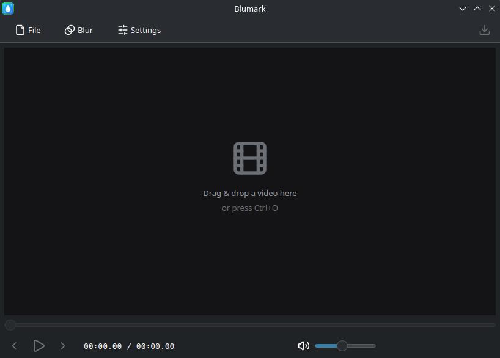

# Blumark



Blumark adalah aplikasi GUI (Graphical User Interface) sederhana untuk menimpa watermark yang terdapat pada video.

## Persyaratan
- [Python 3.10+](https://www.python.org/downloads/)
- [FFmpeg](https://ffmpeg.org/)
  
## Cara Instal

```
sudo apt update
sudo apt install -y git ffmpeg python3-numpy python3-opencv python3-pyside6.qtcore python3-pyside6.qtgui python3-pyside6.qtwidgets python3-pyside6.qtmultimedia python3-pyside6.qtsvg
git clone https://github.com/hyunazmi/blumark.git
cd blumark
python3 -m blumark
```

## Lisensi
[MIT](LICENSE)
