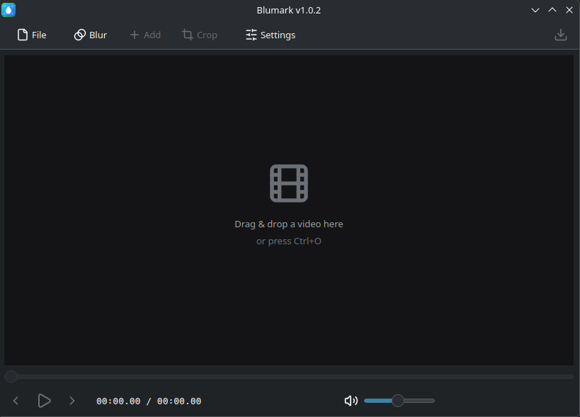

# Blumark



Blumark adalah aplikasi GUI (Graphical User Interface) sederhana untuk menimpa watermark yang terdapat pada video.

## Persyaratan
- [Python 3.10+](https://www.python.org/downloads/)
- [FFmpeg](https://ffmpeg.org/)
  
## Cara Instal

```
curl -fsSL https://raw.githubusercontent.com/hyunazmi/blumark/main/install.sh | bash
```

## Lisensi
[MIT](LICENSE)
